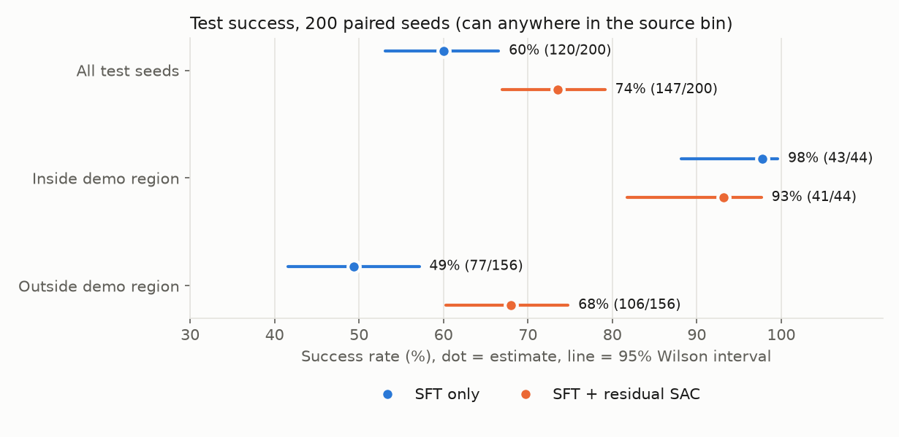
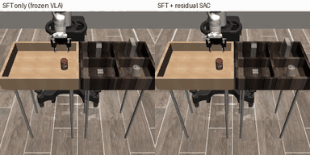

# NewBody-VLA-RL

Lightweight RL post-training for cross-embodiment VLA adaptation, simulation only.

Pipeline: scripted expert on a simulated **Kinova3** (robosuite **PickPlaceCan**) → 50-demo LeRobot dataset →
SFT of `lerobot/smolvla_base` → **frozen VLA + RLT-inspired residual SAC** (VLA features + reference chunk).

**Result** (200 paired test scenes, can anywhere in the source bin): SFT only **60%** → SFT + residual SAC **73.5%**
(31 scenes fixed vs 4 broken, McNemar p = 3.5·10⁻⁶); outside the demonstrated region 49% → 68%.



**Same scene, same frozen VLA** (can outside the demonstrated region, test seed 200003). Left: SFT only, the gripper
comes down slightly off and knocks the can over. Right: with the residual SAC correction, the can is grasped and
placed in the target compartment.



Full-resolution videos: [seed 200003](docs/media/compare_seed200003.mp4), [seed 200008](docs/media/compare_seed200008.mp4)
*(illustrative reruns of scenes where only the RL policy succeeded in the test; the statistic is the 200-scene comparison above).*

- Technical report: [docs/technical_report.md](docs/technical_report.md)
- Scope and decisions: [docs/project_spec.md](docs/project_spec.md), RL design: [docs/m3_design.md](docs/m3_design.md)
- Experiment log with all measurements: [docs/research_log.md](docs/research_log.md)

Status: all milestones done (simulation + demos, SmolVLA SFT, residual SAC, evaluation).

## Install

```bash
uv sync            # Python 3.12; robosuite 1.5.2 + mujoco 3.3.7 + lerobot 0.7.0 (see pyproject.toml for pins)
uv run pytest -q
```

## Scripted expert

```bash
uv run python scripts/run_expert.py --episodes 100 --videos 3
uv run python scripts/run_expert.py --episodes 20 --set carry_z=0.97 --name low_carry   # override an expert param
```

Outputs: `results/expert/<name>/` with `episodes.csv`, `summary.json`, per-step logs and MP4s
(left: agentview, right: wrist camera).

## Demonstration dataset

```bash
uv run python scripts/collect_demos.py --name kinova3_pickplace_can_v1        # train + val splits from config
uv run python scripts/validate_dataset.py --name kinova3_pickplace_can_v1 --split train --replay 5
```

Data goes to `data/<name>/` (LeRobot dataset per split + privileged sidecar for checks; not in git).

## Layout

```
configs/                 env / success / expert / data config (YAML)
src/newbody/env/         Kinova3 PickPlaceCan factory, seeded resets, image helpers
src/newbody/expert/      FSM scripted expert (privileged can + target state)
src/newbody/evaluation/  stricter place-success check
src/newbody/data/        dataset schema + LeRobot recorder
src/newbody/policies/    frozen SmolVLA controller + feature hook
src/newbody/rl/          chunk-level residual env, SAC with asymmetric critic
scripts/                 CLI entry points
tests/                   smoke + regression tests
docs/                    spec, research log, GPU plan, figures
```
