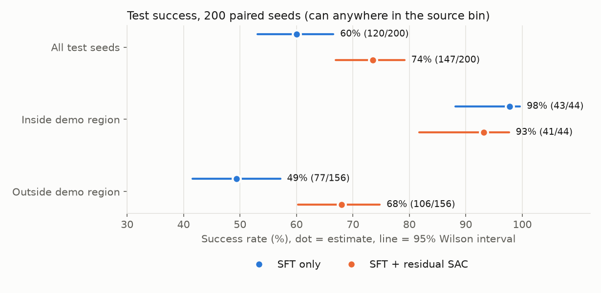
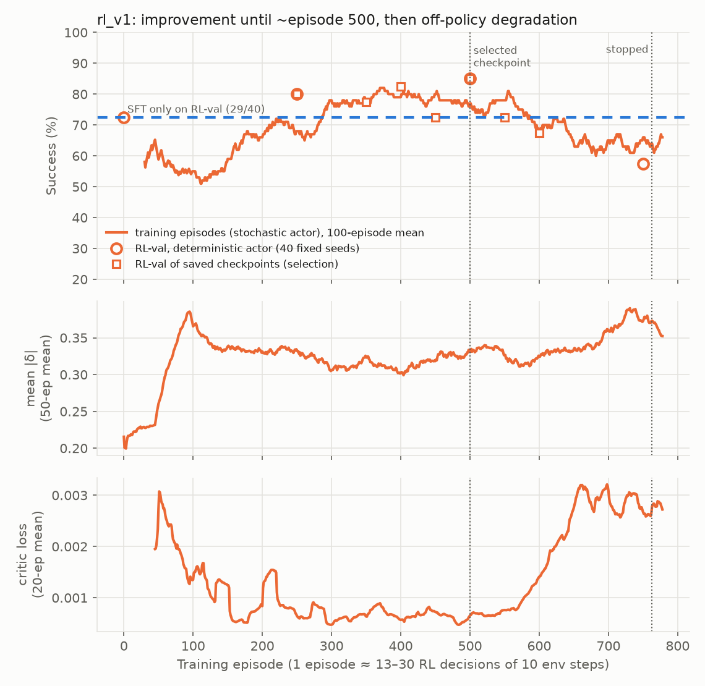
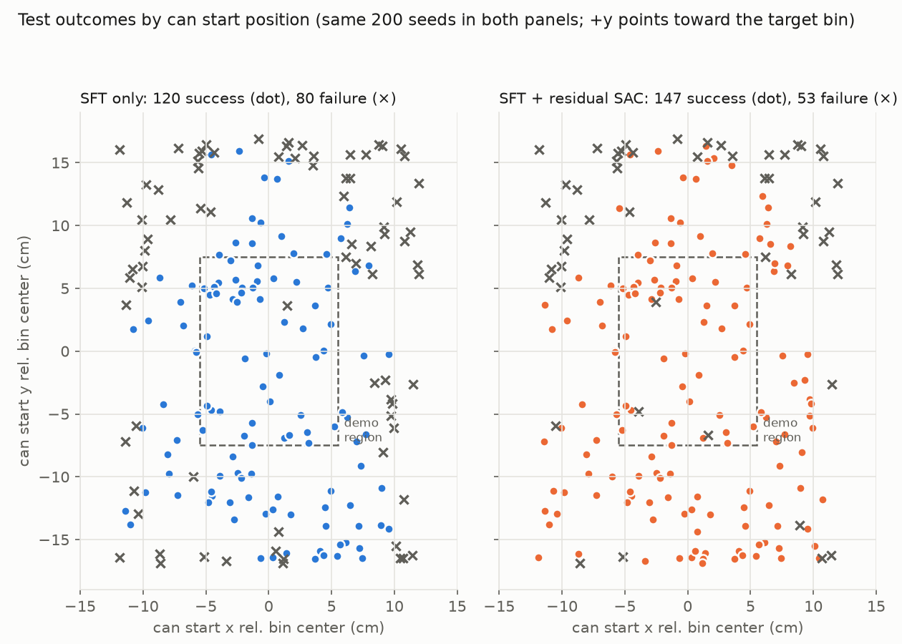
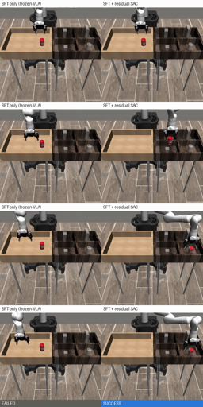

# Lightweight RL Post-training for Cross-Embodiment VLA Adaptation

*NewBody-VLA-RL — technical report (simulation only), November 2026*

## Summary

We adapt the pretrained Vision-Language-Action model **SmolVLA** (`lerobot/smolvla_base`) to a simulated
**Kinova3** arm on robosuite's **PickPlaceCan** task using 50 scripted demonstrations, then **freeze** it and train
a small **residual SAC** policy that corrects the VLA's position commands, using the VLA's own internal features
and its reference action chunk (an idea borrowed from RL Token, RLT).

On 200 held-out test scenes with the can anywhere in the source bin, the frozen SFT VLA succeeds in
**120/200 (60%)**; with the residual policy, **147/200 (73.5%)** on the *same* scenes
(31 scenes fixed vs 4 broken, exact McNemar **p = 3.5·10⁻⁶**). The gain comes from scenes **outside the
demonstration region** (49% → 68%); inside it, performance stays near ceiling (98% vs 93%, not significant).
The residual is small (mean |δ| = 0.30, ≈ 3 mm of extra target offset per step).



## 1. Setup

| Component | Choice |
|---|---|
| Simulator | MuJoCo 3.3.7, robosuite 1.5.2 (pinned; MuJoCo 3.9 silently breaks Robotiq85 closing) |
| Robot / task | Kinova3 + Robotiq85, PickPlaceCan, one instruction: *"Pick up the can and place it in the target bin."* |
| Control | OSC_POSITION, 20 Hz, action = [dx, dy, dz, gripper] ∈ [−1, 1]⁴ (1.0 = 5 cm target offset) |
| Observation (policy) | front + wrist RGB 256², state = gripper xyz + 2 finger joints (5-D), instruction |
| Success | can inside the target compartment **and** released, for 10 consecutive steps (stricter than robosuite) |

Task changes for Kinova3, each justified by measurement (see `docs/research_log.md`): bins moved 15 cm toward the
robot (stock target compartment 9.7 cm out of reach with a vertical gripper); gripper orientation held fixed
(robosuite's OSC_POSITION re-targets orientation to the current one every step, letting it sag up to 40°).

**Demonstrations.** A finite-state-machine expert with privileged state (can and target positions) succeeds
100/100. We recorded 50 train + 10 val episodes (8.3k frames) with the can in a central 11 × 15 cm region of the
source bin, validated by 17 automatic checks including bit-exact open-loop replay. Privileged state is stored only
in a sidecar file, never under `observation.*` keys.

**Splits (by seed, disjoint):** demos 0–49, demo-val 100000+, test 200000–200199, RL training 400000+, RL-val 450000–450039.

## 2. Supervised fine-tuning (SFT)

Official LeRobot recipe: VLM (350M) frozen, action expert + projections (100M) trained with flow matching, batch 64,
50-step action chunks. Our 2 cameras are mapped onto SmolVLA's `camera1/2` (`camera3` absent). Training loss kept
falling (0.041 at 5k steps → 0.012 at 12k), but closed-loop success on the full bin plateaued
(val: 5k 18/40, 10k 22/40, 15k 21/40), so training was stopped at ~16k steps and the **10k checkpoint** chosen on val.

| SFT 10k, test seeds | success | inside demo region | outside |
|---|---|---|---|
| 10 actions executed per chunk | 120/200 (60%) | 43/44 | 77/156 (49%) |
| 50 actions executed per chunk | 60/200 (30%) | 40/44 | 20/156 (13%) |

SFT nearly solves the demonstrated region but generalizes poorly beyond it (distribution shift). Typical failure:
the gripper descends a few cm off and knocks the can over, a state never seen in the demos. Executing long chunks
open-loop halves success, so all further experiments execute 10 actions per chunk.

## 3. Residual RL on the frozen VLA

- **Decision step = one chunk** (10 env steps). The VLA predicts a reference chunk; the RL actor outputs one 3-D
  offset δ ∈ [−1, 1]³ added to the xyz of all 10 actions: `a = clip(a_ref + 0.2·[δ, 0])`. The gripper is never changed.
- **Actor input (deployable only):** frozen VLA features + reference chunk (10×4) + state + time. Features come from
  the VLM prefix pass that already runs for action generation (no extra forward pass): mean of each camera's 64 image
  tokens, concatenated (1920-D). A linear probe showed the front-camera tokens predict the can–gripper xy offset with
  R² 0.81/0.96 (vs 0.07/0.42 from robot state).
- **Asymmetric critic:** additionally sees privileged state (can pose, target, can−gripper offset, grasp flag,
  can tilt). Used only during training.
- **Reward:** +1 on strict success; −0.005‖δ‖² per decision; episode ends if the can tips over.
- **SAC** (adapted from CleanRL): twin critics, automatic entropy tuning (α₀ = 0.01), 4 updates per transition,
  actor initialized to δ ≈ 0, **2000 critic-only warm-up updates** (without them the actor drifted to |δ| ≈ 0.6 on an
  untrained critic).
- **Checks:** with δ = 0 the residual environment reproduces the SFT evaluation action-for-action (difference 0.0);
  VLA weights unchanged.



**Training dynamics.** Success first dipped (episodes ~60–150, right after the warm-up, as early corrections were
poor), then rose to ~79% (training, stochastic) around episodes 300–500, and then degraded: critic loss grew ~5×,
corrections grew, and RL-val success fell to 23/40 at episode 750. This is the familiar off-policy failure where the
actor exploits a drifting critic. We stopped at episode 763 (~1 h 45 min on one RTX 4090 D) and selected the
episode-500 checkpoint by RL-val (pre-registered rule: highest success, ties → earlier).

## 4. Results

| Policy (test seeds 200000–200199, full bin) | success | 95% CI | inside | outside |
|---|---|---|---|---|
| SFT only | 120/200 (60.0%) | 53–67% | 43/44 | 77/156 (49%) |
| **SFT + residual SAC** | **147/200 (73.5%)** | 67–79% | 41/44 | **106/156 (68%)** |

Paired outcomes on identical scenes: both succeed 116, only RL 31, only SFT 4, neither 49 → McNemar p = 3.5·10⁻⁶.



*Illustrative rerun (seed 200003): SFT only knocks the can over; with the residual it is placed (full videos in `results/videos/`).*



## 5. Failure analysis

- **Where RL helps:** the far side of the bin (y < −11 cm: 67% → 90%) and the outer x edges (x ≥ 8 cm: 13% → 45%;
  x < −8 cm: 32% → 54%), i.e. moderate extrapolation from the demo region.
- **Where it doesn't:** 27 of the 53 remaining failures are cans near the wall facing the target bin (y ≥ 11 cm,
  up to 12 cm outside the demo region): 16% → 29%, almost all *never grasped*. In 59% of these failures the residual
  hits its bound (max |δ| ≥ 0.95), versus 0% of successes in the same band and 17% elsewhere, which suggests the
  residual bound (λ = 0.2) limits how far it can pull the VLA. This is correlational; we did not test a larger bound.
- **What RL broke:** 4 scenes (all *tipped*), 3 of them inside the demo region (one inside scene was also fixed: 43 → 41).
- **Remaining failure modes (RL):** never grasped 35, tipped 14, dropped 2, wrong compartment 2.

## 6. Limitations

- One RL training run (one seed); significance is for this trained policy, not across runs.
- The demo region was narrowed in Milestone 1 for expert reliability that later proved unnecessary (expert 59/60
  on the full bin); the restricted-coverage setting was adopted afterwards as a controlled distribution shift.
  In simulation, collecting full-bin demos would likely also fix the shift; the setup models settings where demos are
  expensive and coverage is limited.
- Checkpoint selection is optimistic on RL-val (best of 7 noisy 40-episode evaluations); the test set was used once.
- Training was unstable after ~500 episodes; the result relies on validation-based early stopping.
- Simulation only; actions are Cartesian offsets with a fixed gripper orientation.

## 7. What we would try next

Stabilize off-policy training (lower update-to-data ratio, an actor regularizer toward the reference as in RLT,
critic ensembles), per-step or larger-bound residuals for far extrapolation, more RL seeds, and adding a few
recovery-style demos to compare "more data" against "more interaction".

## Reproduce

```bash
uv sync && uv run pytest -q
uv run python scripts/collect_demos.py --name kinova3_pickplace_can_v1
uv run python scripts/validate_dataset.py --name kinova3_pickplace_can_v1 --replay 50
# GPU server: scripts/server/setup_autodl.md, run_sft_v1.sh, run_rl_v1.sh
uv run python scripts/eval_vla.py --checkpoint outputs/sft_v1/checkpoints/010000/pretrained_model --split test \
    --episodes 200 --n-action-steps 10 --can-x-range -0.145 0.145 --can-y-range -0.195 0.195 --name sft_test
uv run python scripts/eval_residual.py --run rl_v1 --checkpoint ep00499.pt --split test --episodes 200 \
    --baseline results/eval/sft_test/episodes.csv --name rl_test
uv run python scripts/make_figures.py
```
