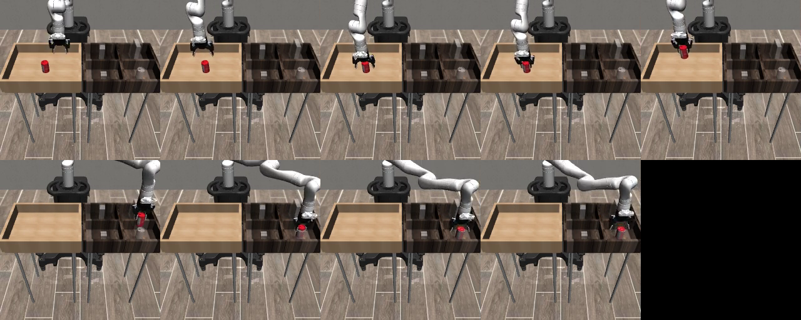

# Chapter 1: Simulation, Scripted Teacher, and Demonstrations

## Where this chapter fits

We want SmolVLA to learn to pick up a can and place it in a target bin, using a robot arm it was not
trained on (Kinova3). A VLA learns by **imitation**, so it needs demonstrations first.

In the real world a human records demonstrations with a teleoperation device.
In simulation we write a program, the **scripted expert** (the "teacher"), that does the task automatically.
It is allowed to cheat: it reads the can's exact position and the target location from the simulator.
Its only job is to produce training data. It is a tool, not the research result.

```
Milestone 1  teacher does pick-and-place (privileged state) -> recorded as a LeRobot dataset   <- this chapter
Milestone 2  fine-tune SmolVLA on that data; it only sees camera images + robot state + text
Milestone 3  freeze the VLA; train a small residual SAC policy that corrects its actions
Milestone 4  compare SFT-only vs SFT + RL on the same held-out start states
```

**Results of this chapter**

- Teacher: **100/100** successful pick-and-place episodes (about 6.4 s each).
- Dataset: 50 training + 10 validation demonstrations, all checks passed (see Section 8).

---

## 1. The scene



*Front camera, one frame at the start of each teacher phase (seed 0).*

- **Left bin (bin1):** the red can starts here, at a random position near the center.
- **Right bin (bin2):** 4 compartments. The can belongs in the back-right one (marked by a gray "ghost" can).
- **Instruction** (the only one in this project): *"Pick up the can and place it in the target bin."*

## 2. What the robot sees: the observation

At every step the simulator returns an **observation**: everything the robot knows at that moment.

| Group | Examples | Available on a real robot? |
|---|---|---|
| **Proprioception** (the robot's sense of its own body) | 7 joint angles, gripper tip position `eef_pos`, finger opening | Yes, from motor encoders |
| **Camera images** | front camera `agentview`, wrist camera `eye_in_hand`, 256×256 RGB | Yes |
| **Exact object state** | `Can_pos`, `Can_quat`, target compartment center | **No** |

Information that exists in simulation but not in reality is **privileged information**.
Project rule: **the teacher may use it; the VLA may not.** The VLA gets only images + proprioception + the instruction.

## 3. What the robot can do: the action

Each step (every 50 ms) the policy outputs **4 numbers** in [-1, 1]:

```
[dx, dy, dz, gripper]
 move the gripper tip in x, y, z  (1.0 = "place a target 5 cm away")
 gripper: -1 = open, +1 = close
```

### Policy vs controller

- The **policy** is the brain: it decides *where to go*.
- The **controller** is the muscles: it turns "go 5 cm up" into torques for the 7 joints.
  We use **OSC (Operational Space Control)**.

An action does **not** teleport the hand. It places a target point, and the controller pulls the hand toward
it like a spring. Measured: commanding "5 cm up" every step moves the hand a steady ~1.2 cm per step;
half the command (0.5) gives ~0.64 cm per step.

> **Why this matters for the project:** the same action produces different motion on a different robot or controller.
> SmolVLA was pretrained on other robots whose 6-D actions were **joint positions**; ours are 4-D **Cartesian
> position offsets**. Learning what the numbers mean for this new body is the core of "cross-embodiment adaptation".

### Why Cartesian position control?

- **Joint space**: command 7 joint angles. Moving 1 cm forward means solving **inverse kinematics** yourself.
- **Cartesian space**: command "1 cm forward"; the controller handles the joints.

A 4-number action is much easier for the VLA and RL to learn. Cost: the gripper always points down; no wrist rotation.
That's fine here: the can is a cylinder, so it looks the same from every rotation around its vertical axis.

### Two clocks

Physics updates every **2 ms** (500 Hz); the policy decides every **50 ms** (20 Hz).
One `env.step(action)` = 1 decision + 25 physics steps. A typical episode is about 130 decisions.

## 4. Making the stock task work for Kinova3

robosuite's `PickPlaceCan` was not designed with Kinova3 in mind. We found three problems by measurement:

**Problem 1: the gripper tilted up to 40°.**
`OSC_POSITION` is supposed to control only position, but robosuite resets the orientation target to
*whatever the current orientation is* at every step. So nothing holds the gripper vertical, and it sags
near the edge of the workspace.
*Fix:* capture the orientation target once at the start of each episode and keep it.

**Problem 2: with the gripper held vertical, the target was out of reach (9.7 cm error).**
The target compartment is at the edge of the arm's **workspace** (the set of positions it can reach).
Without problem 1's fix the arm "reached" it only by tilting 40°, which ruins grasping and releasing.
*Fix:* move both bins 15 cm closer to the robot. All grasp and release points are now reachable within ~1 cm.

**Problem 3: narrowing the can's start region crashed the environment.**
robosuite places all 4 objects (milk, bread, cereal, can) in the left bin and then hides 3 of them.
Squeezing all 4 into a smaller area sometimes has no valid layout.
*Fix:* sample the can first in its small region, then the hidden objects in the full bin.

> **Lesson:** a "standard benchmark task" is still a specific design. When you change the robot, check reach
> and controller behavior with small measurements before writing any policy.

## 5. How the teacher works: a Finite State Machine

The teacher is an **FSM (Finite State Machine)**: a fixed sequence of stages; it moves on when a condition is met.

```
APPROACH  → DESCEND → GRASP     → LIFT      → MOVE           → LOWER       → RELEASE  → RETREAT
above can   to can     close,      up to       over target      into the      open,      straight up
            center     wait 10     carry       compartment      compartment   wait 10
                       steps       height                                     steps
```

Every stage uses the same **P controller (proportional controller)**:

```python
action_xyz = clip(gain * (target - eef_pos) / 0.05, -1, 1)
```

Far away it moves at full speed (the action saturates at ±1); near the target it slows down.
It is **closed-loop**: it re-reads the hand position every step, so lag and small errors get corrected.
The opposite, **open-loop**, sends actions without looking at the result.

> This pair returns in Milestone 2: a VLA that executes a long **action chunk** without looking again is closer to open-loop.

Code: `src/newbody/expert/fsm_expert.py`.

### One design choice we measured: carry height

| carry height | success (30 episodes) | why |
|---|---|---|
| 1.05 m | 24/30 | arm can't stretch to the point above the target at that height |
| 1.00 m | 29/30 | one reach failure |
| 0.97 m | 30/30 | but only **1 cm** above the bin walls: a small slip would hit a wall |
| **1.00 m + start lowering within 3 cm of target** | **100/100** | 4 cm wall clearance; avoids the most stretched pose |

We rejected 0.97 m even though it scored 30/30, because the margin was too small. A good engineering
choice is about robustness, not just the number on one run.

## 6. What counts as "success"?

robosuite's rule: the can is in the target compartment **and** the gripper is a few cm away, **at one instant**.

Our stricter rule: the can is in the target compartment **and** the gripper is no longer holding it,
for **10 consecutive steps**. So the can has really been released and stays there.

> **Why be strict?** In RL (Milestone 3) the agent will exploit any loophole in the scoring rule.
> That is **reward hacking**, one of the most common RL pitfalls.

## 7. Two silent bugs we found (and why they matter)

Both produced **no error message**, only worse behavior:

1. **Physics version.** On MuJoCo 3.9.0 the gripper could not close below 6.3 cm, so it could not hold
   a 4 cm object. On 3.3.7 it closes to 1.5 cm. Found by: success grouped by object rotation → contact check → measuring finger gap.
2. **Gripper tilt** (Section 4). Found by printing the gripper orientation during reach tests.

Both are now covered by regression tests (`tests/test_env.py`).

> **Lesson:** when success is low, first find *which layer* is broken (physics? controller? policy?) with the
> smallest experiment. Otherwise you train a VLA on bad data and blame the model.

## 8. From teacher to dataset

*(Section completed after collection — see below.)*

---

## Interview check

Answer in English (3–5 sentences each), then send your answers for feedback.

1. *What is the difference between the policy and the controller in your setup, and why does it matter for adapting a pretrained VLA to a new robot?*
2. *Your scripted expert reads the exact can position. Why is that allowed for the expert but not for the VLA?*
3. *You changed the stock robosuite task. What did you change, and how did you justify each change?*

## Concept recap

- **Observation / Action**, **Proprioception**, **Privileged information**
- **Policy vs Controller**, **OSC**, **Joint space vs Cartesian space**
- **Workspace / reachability**
- **Control frequency (20 Hz) vs simulation frequency (500 Hz)**
- **P controller, closed-loop vs open-loop**
- **FSM**
- **Success condition, reward hacking**
